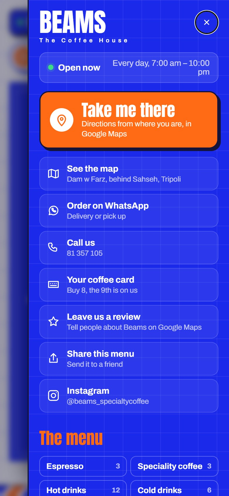
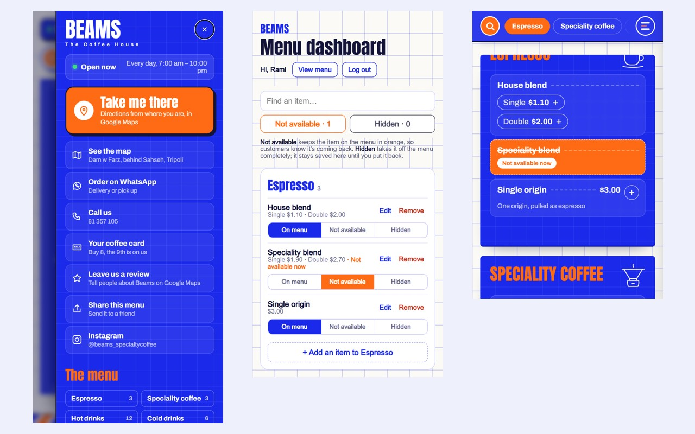

# Beams menu

The menu website for Beams Specialty Coffee in Tripoli, built for a real café and live at **[beams-menu.vercel.app](https://beams-menu.vercel.app)**.

Customers browse the menu on their phone and send their order straight to the café on WhatsApp. Baristas log in to their own page to edit the menu, and when something runs out they mark it "not available" and it turns orange on the menu right away.





It works together with the [Beams loyalty card](https://github.com/jad-obeidd/beams-loyalty): baristas use the same name and PIN in both apps.

## What's in it

- `/` the menu: categories, prices, a cart, and ordering through WhatsApp
- `/admin` barista login, then add, edit, hide or delete items and mark them not available
- `/cashier` a till for events: take orders, work out change in USD or LBP, and send the day's sales summary to the owner on WhatsApp
- `/stock` a stock count that builds the shopping list and sends it to the owner

## Built with

Next.js 15, React 19, TypeScript, Supabase (Postgres), Vitest. Deployed on Vercel.

## Run locally

```bash
npm install
npm run dev
```

Without Supabase settings the app reads and writes `data/*.json`, which is fine for local testing.

To go live, run the `supabase-*.sql` files in the Supabase SQL editor, then set these on Vercel:

| Variable | What it is |
| --- | --- |
| `SUPABASE_URL`, `SUPABASE_SERVICE_ROLE_KEY` | The Supabase project, server side only |
| `SESSION_SECRET` | Any long random string, signs the staff login cookie |
| `NEXT_PUBLIC_OWNER_WHATSAPP` | Owner's WhatsApp number for sales and stock reports, digits only |

## Security

- Each barista logs in with their own name and PIN. PINs are stored as salted scrypt hashes, never as text.
- Staff sessions last one shift (12 hours) and are signed with HMAC.
- The database is only reachable from the server with the service role key.
